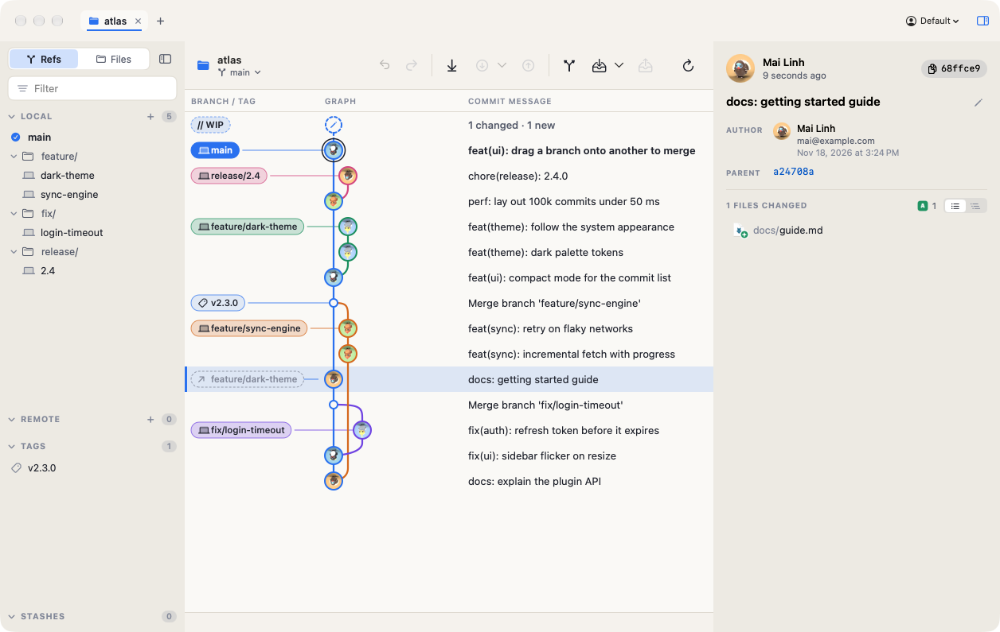

<p align="center">
  
</p>

<h1 align="center">GitLoom</h1>

<p align="center">
  A free, native Git client for macOS.<br>
  See your history. Change it by dragging.
</p>

<p align="center">
  <a href="https://github.com/Jarvis219/gitloom-site/releases/latest/download/GitLoom.dmg"><b>Download for macOS</b></a> ·
  <a href="https://gitloom-site.vercel.app">Website</a> ·
  <a href="https://gitloom-site.vercel.app/docs/">Docs</a> ·
  <a href="https://gitloom-site.vercel.app/changelog/">Changelog</a> ·
  <a href="https://gitloom-site.vercel.app/support/">Support</a>
</p>

<picture>
  <source media="(prefers-color-scheme: dark)" srcset="public/shots/graph-dark.png">
  
</picture>

GitLoom is built with Swift and AppKit, not Electron. It's a 42 MB download for Macs with Apple silicon, needs no
account and sends no telemetry. It runs your own `git`, so your config, hooks, credentials and aliases all apply,
and you can switch to the terminal at any moment.

## Features

- **A commit graph for big repositories.** Every branch keeps its own lane and colour. The first rows of a
  100,000-commit repository show in about 0.15 s, the full history in about 0.7 s.
- **Drag and drop.** Drop one branch onto another to merge, rebase or cherry-pick. Reorder an interactive rebase by
  dragging commits.
- **Stage single lines**, not just whole files, and write the message next to the diff.
- **Undo almost everything.** <kbd>⌘Z</kbd> undoes commits, checkouts, merges, resets and branch changes;
  <kbd>⇧⌘Z</kbd> redoes them. The reflog covers anything older.
- **A three-way conflict editor**, file history that follows renames, blame and search across every commit.
- **Profiles** keep work and personal apart: their own tabs, recent repositories and commit identity. SSH accounts
  pick the right key for each repository.
- **GitHub and GitLab built in**: pull requests and reviews, issues, and GitHub Actions runs next to the history
  they touch.
- **The rest of Git close at hand**: a built-in terminal and file editor, worktrees, submodules, bisect, Git LFS and
  a `gitloom` command-line tool.
- **AI with your own provider and key**, off by default, and an MCP server for other AI tools, also off by default.
- **16 languages**, light and dark themes, and your own layout and shortcuts.

## Install

1. [Download GitLoom.dmg](https://github.com/Jarvis219/gitloom-site/releases/latest/download/GitLoom.dmg) and drag
   GitLoom to Applications.
2. Open it. macOS stops the first launch because GitLoom isn't notarized by Apple yet.
3. Go to **System Settings ▸ Privacy & Security** and choose **Open Anyway**. You only do this once.

Or from Terminal:

```sh
curl -LO https://github.com/Jarvis219/gitloom-site/releases/latest/download/GitLoom.dmg
```

Requirements: macOS 14 or later on Apple silicon, and git 2.40 or later (`xcode-select --install` or Homebrew).

Updates are signed with an EdDSA key and checked before they install; GitLoom installs only newer versions.
See [Security](https://gitloom-site.vercel.app/security/) for how to verify a download.

## Help

- [Docs](https://gitloom-site.vercel.app/docs/): the window, everyday work, history, tools, accounts, AI and settings.
- [Support](https://gitloom-site.vercel.app/support/): fixes for the most common questions.
- [Report a bug](https://github.com/Jarvis219/gitloom-site/issues/new?labels=bug) or
  [request a feature](https://github.com/Jarvis219/gitloom-site/issues/new?labels=enhancement). Issues are public:
  never paste tokens, passwords, SSH keys or private code.
- Security problems: please don't open a public issue. See
  [Report a vulnerability](https://gitloom-site.vercel.app/security/#report).

GitLoom is free to use. Its source code isn't published; this repository holds the website, the releases and the
issue tracker. See [Privacy](https://gitloom-site.vercel.app/privacy/) and [Terms](https://gitloom-site.vercel.app/terms/).

## This repository

The website at [gitloom-site.vercel.app](https://gitloom-site.vercel.app) is built with [Astro](https://astro.build)
in 16 languages and deployed by Vercel on every push to `main`. The app's update feed is `public/appcast.xml`.

```sh
pnpm install
pnpm dev                 # http://localhost:4321
pnpm build               # static site in dist/
```

| Path | What |
|---|---|
| `src/components/Home.astro` | The landing page |
| `src/views/` | Docs, download, changelog, support, legal, press, compare, search and 404 |
| `src/content/docs/` | Docs articles (English at the top, translations in `<lang>/`) |
| `src/i18n/` | Landing text (`landing*.ts`), sub-page text (`pages/<lang>.ts`), locales |
| `public/appcast.xml` | Sparkle update feed, written by the app's release script |
